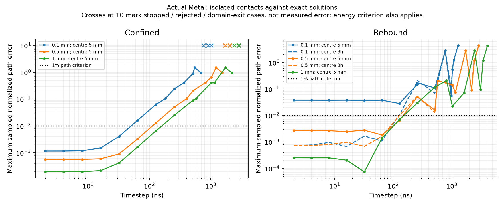

# Isolated contact timestep studies

The 424-grain preparation was stopped at the user's request after its completed
million-step checkpoint. Process-tree termination and exit143 are recorded in
`evidence/hostun-balanced424-user-stop-v1/report.json`; completed checkpoints and
the interrupted next chunk are retained. No preparation acceptance is inferred.
The original parent manifest's running status is interrupted evidence, not a live
process or an accepted terminal result.

## Method frozen before execution

`contact-timestep-limits-v1` runs96 actual-Metal cases: three cube sides
(0.1,0.5,1mm), two contact fixtures, and16 timesteps per fixture. Density2650kg/m³,
normal traction stiffness1e12N/m³ and tangential stiffness5e11N/m³ match the
engineering preparation. Friction, viscosity and drag are zero. Six face-centre
samples carry exact face areas; the active normal-face resultant is exactly
Kδ, K=kn*h², while the face remains the sole contacting face. Original cube
meshes determine mass/inertia. This isolates contact integration from mesh-query
and quadrature error; it does not test an irregular grain pair.

For rebound, a cube starts with penetration a=0.001h and zero velocity against
one fixed plane. With m=rho*h³ and omega²=K/m, penetration is a*cos(omega*t)
until t=pi/(2omega), then -a*omega*(t-pi/(2omega)); velocity follows its derivative.
For confinement, opposing planes each preload by d=0.01h. An initial displacement
a=0.001h yields net force -2Kx, omega²=2K/m, and x=a*cos(omega*t), while both faces
remain active. The independently computed dynamic energy subtracts the constant
preload energy Kd². Loss of the confined analytical domain is retained as failure
of that reference's applicability, not assigned a sinusoidal solution thereafter.

Each run lasts at least4pi/omega, rounded up to an integer number of steps.
Physical steps2,4,8,16,32,64,128,256,512,1024ns are supplemented by omega*dt
values0.5,1,1.5,1.9,2.1,2.5. The ideal bilateral kick-drift-kick recurrence has
trace2-(omega*dt)² and unit determinant; its strict bounded oscillatory domain is
0<omega*dt<2. The unilateral rebound need not diverge above that threshold:
an inaccurate kick can simply launch it away from the plane.

A research-only Engine subclass records and bypasses the existing conservative
timestep preflight. Production Engine, kernels, material parameters, overlap guard
and rollback are unchanged. Observations occur every16 steps and at endpoints;
metrics are sampled maxima, not continuous-time suprema. Accurate means complete,
inside the declared analytical domain, sampled displacement/velocity error<=1%
(normalized by a and a*omega), and independently computed dynamic-energy error<=1%.
Energy above10times the initial dynamic energy triggers a prospectively declared
stop. All rejections, stops and domain exits remain in the results. The study is
exploratory: completeness does not mean every timestep passes.

## Results

All96 cases were recorded, and all prospective source hashes matched on completion.
Immutable source snapshots independently reproduce their recorded hashes.

| Cube side | Confined production bound | Largest tested accurate confined step | Ideal confined stability threshold |
|---|---:|---:|---:|
|0.1mm|4.67ns|32ns|728ns|
|0.5mm|10.44ns|64ns|1628ns|
|1mm|14.77ns|128ns|2302ns|

These are discrete tested values over two periods, not maximum admissible steps.
The accurate steps exceed the conservative checks by roughly6–9times. Confined
runs above omega*dt=2 trigger the declared divergence stop; an additional smallest
fixture case is rejected by the solver. Large finite rebounds can still be grossly
inaccurate. Bounded motion is insufficient evidence of useful accuracy.

The smallest rebound fails the1% path check even at2ns:3.76397% sampled error,
with0.64288% dynamic-energy error. Reducing timestep does not eliminate this floor.
The separately frozen `contact-timestep-origin-diagnostic-v1` repeats32 rebound
cases for0.1/0.5mm cubes, translating each whole fixture from centre5mm to centre3h.
Physics, timestep list, duration and acceptance criteria are unchanged. At2ns the
0.1mm path error falls to0.072779%, with0.013096% energy error; the largest tested
accurate rebound steps are64ns and128ns respectively. All32 cases and source
hashes complete. This demonstrates coordinate sensitivity, without assigning its
entire cause to a specific arithmetic operation. The plane shader currently forms
position+arm before subtracting the plane offset; compensated particle and plane
state do not guarantee that this intermediate is free of cancellation error.
The original failure remains retained; the translated fixture does not replace it.



The original `timestep-error.png` is retained. The comparison plot marks rejected,
stopped or domain-exit cases separately, since rollback can otherwise leave a
small observed error at a rejected large step. No rejected step is counted accurate.

## Reproduction and limits

Run serially on Metal, with a fresh output directory:

```sh
PYTHONPATH=src .venv/bin/python examples/contact_timestep_study.py \
  studies/contact-timestep-limits-v1.json --output evidence/contact-timestep-limits-new
PYTHONPATH=src .venv/bin/python examples/contact_timestep_study.py \
  studies/contact-timestep-origin-diagnostic-v1.json --output evidence/contact-timestep-origin-new
```

Each output contains the pre-execution freeze, full package/shader/driver snapshot,
per-case trajectories and failures, and a complete summary. The original driver's
snapshot retains its exact pre-diagnostic bytes. Current driver adds optional
fixture translation; omitted translation retains the original5mm centre.

Next study: irregular grain-to-grain normal and tangential contacts with rotation,
changing contact area and stiffness/Jacobian estimates, plus translated copies to
separate coordinate error. Compare accuracy over fixed physical durations and
refinement before proposing a production timestep policy. No general Hostun
step increase, dense assembly qualification, frictional timestep limit or
scientific validation is established by these analytical fixtures.
