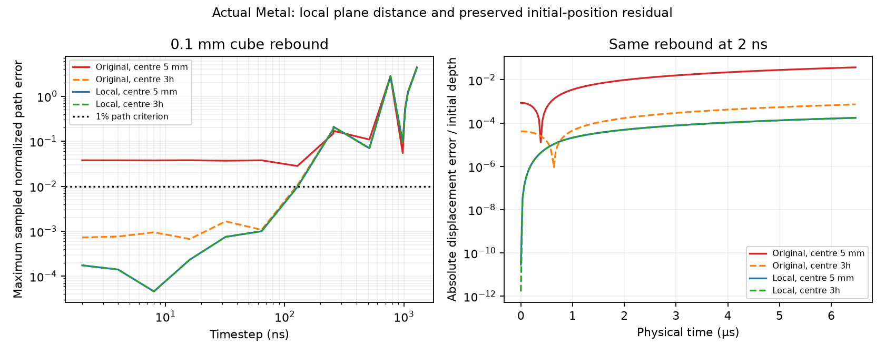

# Local plane-contact arithmetic

The production wall collector now evaluates plane penetration relative to each
particle centre. It preserves the two-component initial particle position rather
than discarding the initial FP32 rounding residual. These changes address the
coordinate sensitivity observed in the isolated contact studies; they do not
change stiffness, timestep, contact area, friction or overlap policy.

## Calculation

For a plane with unit inward normal n, offset d, particle centre x and rotated
surface arm a, the signed distance is

    phi = (n · x - d) + n · a

The previous implementation first formed the world-space surface point x+a in
FP32, then subtracted d. When a shallow penetration is much smaller than x, that
intermediate can lose important digits. The new implementation forms a local
plane offset at the particle centre and combines it with the small surface arm.

The centre/plane calculation uses existing high/low particle and plane state.
Two-component sums retain subtraction and accumulation residuals, and fused
multiply-add recovers product residuals. Explicit bitwise materialization through
the immutable runtime-zero mask prevents Metal fast-math from reassociating away
the compensation. The normal's stored low component participates in distance
projection, including for oblique planes. Slang documents its
[FMA intrinsic and Metal availability](https://docs.shader-slang.org/en/latest/external/core-module-reference/global-decls/fma.html).
The final distance, contact force and torque remain FP32. This is compensated
FP32 arithmetic, without a device FP64 requirement.

The production collector, early centre-radius rejection and sample-hierarchy bound
use the same centre-distance calculation. The original conservative bound padding
is retained. Contact forces still act at the original local surface arm, with the
existing normal traction/friction contract. Moving wall offsets retain their
existing compensated update. Particle initialization now fills positionRemainder
from the normalized FP64 input minus its FP32 high component; checkpoint formats
already contain that buffer and need no format change.

Grain-to-grain geometry already queries in relative/body coordinates. This change
specifically qualifies production plane penetration and initial position storage;
it does not establish universal translation invariance of every diagnostic or
legacy standalone probe accepting already-rounded world-space input.

## Frozen actual-Metal evidence

`contact-local-frame-v1` checks 12 static cases: a 0.1 mm cube with exact
face-centre quadrature, penetration scale 0.1 µm, three axis/oblique normals, and
centres at 0.3 mm, 5 mm, 0.5 m and 5 m. An independent FP64 SI evaluation supplies
force, local torque and active counts. All cases pass the prospectively frozen
1e-4 relative force/torque and 1e-7 grain-size-normalized initial-position gates.
Worst relative force error is below 1.5e-5; all counts agree. This spans centre/size
ratios from 3 to 50,000. It is finite coverage, not an unlimited-coordinate claim.

`contact-local-frame-timesteps-v1` repeats all 96 original trajectory cases at
their original coordinates, with identical physics, timesteps, horizons and
acceptance criteria. `contact-local-frame-origin-v1` repeats all 32 original
translated rebound cases. All cases are recorded and all source hashes match.
Divergence, rejected steps and inaccurate large steps remain retained. Fixing
coordinate arithmetic does not remove the explicit integrator's timestep limits.

At 2 ns, the problematic 0.1 mm rebound at its original 5 mm centre changes from
3.76397% to 0.0174809% maximum sampled normalized path error. Independent dynamic
energy error changes from 0.642884% to 0.00289363%. The initial geometric-position
error is also reduced. No acceptance threshold was changed.

| Cube side | Original maximum normalized difference between translated trajectories | New maximum normalized difference |
|---|---:|---:|
| 0.1 mm | 0.0383675 | 9.80119e-10 |
| 0.5 mm | 0.00342439 | 1.40469e-9 |

Differences compare the complete paired 2 ns observation histories at identical
times, normalized by initial displacement and its oscillator velocity scale.
The remaining analytical error of about 0.0175% is distinct from the much smaller
translation difference; sample representation and integration still have finite
precision. The evidence does not isolate the separate contribution of every
remaining error source.



`contact-local-frame-integration-v1` runs the complete current pytest suite serially
with Metal enabled: **286 passed, 8 skipped**, in 41.56 seconds. All 215 frozen
source, test, case and protocol files are unchanged. The suite includes six new
shallow-contact force/torque/initial-position regressions at 5 mm and 5 m, plus
existing moving-wall, friction, rollback, restart and active-history checks.
Environment-dependent skips remain explicit; no new native Atlas binary was built.
No throughput, dense-assembly or scientific admission follows from these checks.

## Reproduction

Run GPU workloads serially with a fresh output directory:

```sh
PYTHONPATH=src .venv/bin/python examples/contact_local_frame_study.py \
  studies/contact-local-frame-v1.json --output evidence/local-frame-static-new
PYTHONPATH=src .venv/bin/python examples/contact_timestep_study.py \
  studies/contact-local-frame-timesteps-v1.json --output evidence/local-frame-timesteps-new
PYTHONPATH=src .venv/bin/python examples/contact_timestep_study.py \
  studies/contact-local-frame-origin-v1.json --output evidence/local-frame-origin-new
SAND_DEM_METAL=1 PYTHONPATH=src .venv/bin/python -m pytest -q
```

Each numerical study retains a pre-execution source freeze and immutable source
snapshot. The retrospective comparison separately freezes its input identities.
The original failed coordinate studies and interrupted Hostun preparation remain
unchanged. No preparation is restarted automatically with the new arithmetic;
new assembly evidence must have a distinct solver/study identity. Irregular pair
contacts with rotation and friction remain the next timestep-policy study.
