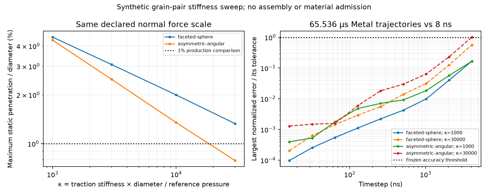

# Pressure-normalized contact stiffness

The requested sweep is complete: eight static pair-load setups, 72 short and
40 longer actual-Metal trajectories. It does not support automatically selecting
kappa=1000 with the existing 1% penetration criterion. All production stiffness,
timestep and overlap defaults remain unchanged; the preparation remains stopped.

## Frozen definition and fixtures

For this traction law, use kappa=kn_star*d_ref/p_ref, where kn_star is in Pa/m.
The declared reference diameter is the prior Hostun library's median equivalent
volume diameter, 0.339347932 mm; reference pressure is 10 kPa and density is
2650 kg/m³. Each run fixes kn_star=kappa*p_ref/d_ref, kt/kn=0.5 and friction=0.5,
with zero contact viscosity and drag. There is no pressure-adaptive stiffness.

Both fixtures are original procedural convex solids: a physical 320-face
icosphere mesh and an asymmetric angular convex hull generated from perturbed,
anisotropically scaled icosphere vertices. Each is scaled to the same equivalent
volume diameter. The angular target is rotated and offset transversely. Its
source recipe is frozen in the driver; no Sand Atlas geometry or mineral property
is inferred from these synthetic shapes. The faceted sphere is not an exact
analytical sphere, Hertz contact or a geometry-refinement study.

The single-contact normal-force target is p_ref*d_ref². This is an explicit load
scale, not proof that one contact represents a specimen at that bulk pressure.
Independent FP64 convex half-space geometry finds the first shallow inward load
crossing. For interior points of a convex solid, the nearest supporting plane
supplies the signed boundary distance; exterior points carry no traction. The
reference integrates the project's two half-weighted passes and centre torques.
Four independent flat-face/empty-contact algebra checks pass on the CPU; no CPU
simulation advances a trajectory.

Production mesh-BVH queries use fixed source-triangle Gauss3 quadrature at level 2
for the faceted sphere and level 3 for the angular grain (15,360 nodes per body).
Two separately evaluated finer levels challenge static integrals. Finest change
is at most 0.5895% (frozen limit 2%); working/reference force difference is at
most 2.5277% (limit 5%). GPU force error against its identical-node independent
oracle is at most 6.164e-6 relative (limit 1e-3); all static force/torque gates pass.
These static checks do not establish convergence of the entire dynamic contact
history or an arbitrary mesh library.

The study-only timestep preflight override records the production acceptance or
rejection. A declared 15% diagnostic penetration guard permits measuring soft
contacts; comparison against the unchanged 1% production criterion is separate.
Neither diagnostic setting is admitted into a production recipe.

## Static results

| kappa | kn_star (Pa/m) | Faceted-sphere maximum penetration/d | Angular maximum penetration/d |
|---:|---:|---:|---:|
|1000|2.947e10|4.536%|4.344%|
|3000|8.840e10|3.074%|2.494%|
|10000|2.947e11|1.997%|1.349%|
|30000|8.840e11|1.329%|0.787%|

Only the angular kappa 30000 case meets the original 1% comparison at this load.
Local contact traction exceeds the nominal pressure scale; kappa 1000 therefore
does not imply0.1% penetration. Changing active area also changes the tangent.
Independent local normal periods range from 73.40 to 40.33 us for the faceted sphere,
and 82.65 to 34.52 us for the angular fixture as kappa rises 1000→30000. Thus the
endpoint period ratios are 1.82 and 2.39, rather than sqrt(30). A fixed-area
square-root stiffness estimate does not describe this entire change of loaded pose.

## Dynamic accuracy, with explicit scales

The short study runs all eight setups at 1,2,4,8,16,32,64,128,256ns for 8.192 us,
observed every 256 ns. A small antisymmetric initial tangential velocity exercises
friction; translation and rotation are free. Each run starts from the same
load-root pose within a stiffness case. The 1 ns reference and 2 ns next refinement
agree under all gates; every tested timestep passes over this short window.
The 256 ns endpoint is therefore a censored sweep boundary, not a maximum timestep.

The separately frozen long challenge retains both fixtures and the endpoint
kappas 1000/30000 for 65.536 us. Steps are 8..4096 ns in powers of two, with an 8 ns
reference and 16 ns support check. All four support checks pass. Comparisons are at
common 4.096 us observation times, including initial/final states; these are sampled
errors, not continuous-time maxima. Fine references record nonzero friction loss
and rotation excursions of 0.015–0.109rad.

Accuracy requires the following frozen maximum errors simultaneously:

- position difference/d_ref <= 0.001;
- velocity difference/sqrt(p_ref/rho) <= 0.01;
- quaternion geodesic rotation difference <= 0.001rad;
- force difference/(p_ref*d_ref²) <= 0.02;
- torque difference/(p_ref*d_ref³) <= 0.02.

These are errors on declared physical scales, not 1% of each instantaneous value.
The reference is a finer trajectory of the same discrete GPU model, not an
independent dynamic solution. Spring-energy proxy and friction loss are retained;
no exact elastic-potential identity or dynamic energy acceptance is asserted.

| Fixture | kappa | Largest tested step passing all long-study gates |
|---|---:|---:|
|Faceted sphere|1000|4096ns, upper sweep boundary|
|Faceted sphere|30000|4096ns, upper sweep boundary|
|Angular|1000|4096ns, upper sweep boundary|
|Angular|30000|2048ns;4096ns fails|

The last case fails its frozen rotation gate: 1.01528 mrad versus 1 mrad.
Its 4096 ns force error is 1.8973% of the declared force scale; the rotation failure
is retained without relaxing the criterion. No trajectory is rejected or made
nonfinite in these sweeps. Stability limits are not identified for the three
upper-boundary cases, and no dense-assembly timestep is established.



## Preserved setup failure and reproducibility

`normalized-stiffness-contacts-v1` fails before GPU execution: its fixed root
bracket included very deep interpenetration where the contact resultant reverses,
so endpoint values did not bracket the target. Its source archive, trace, private
asset and failure receipt remain intact. V2 searches inward from separation for
the first load crossing; physical cases and accuracy gates are unchanged. The
long challenge has its own protocol and freeze, declared before its execution.
The generic reference labels in the current driver support its 8 ns reference;
the earlier driver and 1 ns/2 ns labels remain exact in V2's immutable snapshot.

```sh
PYTHONPATH=src .venv/bin/python examples/normalized_stiffness_study.py \
  studies/normalized-stiffness-contacts-v2.json --output evidence/stiffness-short-new
PYTHONPATH=src .venv/bin/python examples/normalized_stiffness_study.py \
  studies/normalized-stiffness-contacts-long-v1.json --output evidence/stiffness-long-new
PYTHONPATH=src .venv/bin/python -m pytest -q tests/test_normalized_stiffness_reference.py
```

Run GPU studies serially. Each fresh output freezes the package, shaders, driver,
imported research helper and protocol before execution. All 112 trajectories and
source-integrity checks complete. Independent static gates are evaluated under
the original policy by `evidence/normalized-stiffness-summary-v1/analyze.py`;
that retrospective analysis freezes its input files separately.

The next practical step is a contact-aware timestep policy qualified on multi-contact
and rotational cases, together with a stiffness/shape/loading-rate study of a
small dense assembly. The existing conservative preflight is much smaller than
the passing isolated-pair steps here, even at near-current stiffness. These results
motivate that work; they do not authorize increasing a full specimen's timestep,
selecting kappa 1000 by default, or restarting the interrupted preparation under
its old study identity. Calibration and validation remain separate requirements.

The subsequent opt-in contact-aware implementation and its separate synthetic
multi-contact/rotational qualification are recorded in
[CONTACT_TIMESTEP_POLICY.md](CONTACT_TIMESTEP_POLICY.md). This does not change the
above112 trajectories, stiffness choices or retained failures.
