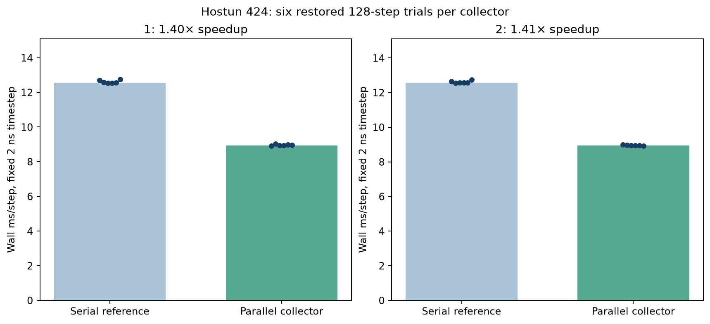

# Parallel mesh contact collection

The production mesh collector now distributes each directed surface tree across
32 disjoint subtrees. A pool of 4096 GPU workgroups processes the actual candidate
work count, without CPU count readbacks or indirect dispatch. Pair-relative
transforms are computed once, then reused to bound every source subtree using
center/extents. Node distance queries, physical triangles, quadrature, two directed
half-weighted passes and persistent sample keys remain the same.

The final revision measures 1.405x faster ordinary advancement on the frozen
dilute Hostun checkpoint: 12.5820 → 8.9538 ms/step (28.8% less wall time).
The earlier frontier-only revision measures 12.5687 → 8.9462 ms/step; hoisting
transforms adds no measurable benefit on this sparse case. Both revisions have
separate source snapshots and benchmark identities.
These are end-to-end advancement wall times at the same 2 ns timestep; setup,
checkpoint reset and warmup are excluded. A dense irregular specimen remains an
open performance study. Static geometry caching is not implemented here.

## Scheduling and conservative bounds

The existing binary source-sample tree and triangle BVHs are retained. During
packing, the largest available subtree is split until 32 roots or all leaves are
selected. The roots cover all original sample indices exactly once; padding slots
have zero end links. No sample is regenerated, removed, renumbered or reweighted.
Each subtree preserves the existing preorder escape links and leaf evaluation.

A root mask is computed once for each candidate pair's two directions using the
original corner-based conservative test. The persistent pool walks all 64 logical
tasks per pair (two directions times 32 roots) by uniform strides of 4096. A task's
workgroup has 64 lanes. All lanes reach every group barrier, including after a
contact-capacity failure. Idle groups do no work; the pool does not reserve a task
queue with a truncation limit. The task domain is derived from the GPU's current
candidate count, bounded by the existing pair capacity.

For a directed pair, source coordinates map to target coordinates through an
affine 3×3 matrix and offset. Three transformed basis vectors and the translated
origin are stored once. A source AABB with center c and half-extents h transforms
to center `A*c+b` and half-extents `abs(A)*h`. The resulting box encloses the same
exact affine images of all eight source corners. The new path pads it outward by
256 FP32 epsilons times the declared output/branch magnitude scale to cover
composition, center/extent and dot-product rounding. Root masks retain their
original 64-epsilon corner path. Both feed the same target-AABB/hull-plane predicate.
GPU node contacts still use their original local-frame coordinate calculation.
Independent FP64 corner checks cover random rotations and unequal scales before
performance acceptance. This is bounded evidence, not an assertion that arbitrary
malformed/nonunit orientations are supported.

Force and torque gathering now uses compensated FP32 accumulation, followed by a
rounded high-plus-low result. Parallel contact append order is intentionally free;
persistent keys, rather than append offsets, continue to bind friction history.
Compensation reduces accumulation-order sensitivity without changing the contact
law or integrating on the CPU. Stress and energy diagnostics retain their existing
reductions. No bitwise identity for all diagnostics or all devices is claimed.

Additional device storage is 4 bytes for the root mask plus 128 bytes for directed
transforms per reserved pair, and 512 bytes of static frontier data per shape.
The conservative memory preflight includes it. These arrays are derived data,
rebuilt before each collection, with no checkpoint format change. Capacity-growth
retry and transactional advancement rollback retain their existing behavior.
The old serial collector remains as an internal verification reference, rather
than a public numerical profile.

## Qualification and retained failures

All GPU runs are serial and explicitly Metal. Gates and sources are frozen before
execution. Performance studies require at least 1.2x median speedup and preserve
all state/history equivalence gates; no gate has been relaxed after failure.

- `parallel-mesh-qualification-v1`: 302 pass, seven fail, eight skip. The backend
  exposes `dispatch_compute_indirect` but reports it unsupported at execution,
  leaving mesh contacts empty. The initial microscopic annulus constructor also
  failed solid validation. Exact source and failures are retained.
- `parallel-mesh-qualification-v2`: 308 pass, one fail, eight skip. The persistent
  pool replaces unsupported dispatch; the annulus is constructed in micrometres
  and explicitly scaled, without repair. A dynamic concave normal component
  differs by 1.464e-7, beyond its frozen 1e-7 absolute threshold, after contact-order
  roundoff perturbs motion. The failed result remains.
- `parallel-mesh-qualification-v3`: 309 pass, eight skip. Compensated force/torque
  gathering passes the unchanged convex/concave force, normal, history and state
  comparisons, plus the complete existing suite.
- `parallel-mesh-qualification-v4`: 312 pass, eight skip. Hoisted transforms add
  three independent GPU-bound/FP64-corner cases, including scale ratios 20 and 1/20.
  All frozen source files remain unchanged through execution.

Coverage includes exact frontier key partitioning for uneven trees, convex and
concave static/dynamic contacts, restart, friction history, growth/overflow,
periodicity, nonperiodic domains, damping, active-contact timestep rollback,
independent contact references and the existing dense 27-grain fixture. Passing
these software checks is separate from dense Hostun/material qualification.

## Same-state performance studies

The immutable 500k-step checkpoint has 424 grains, 53 reused shapes and 53,564,544
quadrature nodes in the library. It starts with 347 candidates, two active pairs
and 956 active surface contacts. Each mode restores the identical checkpoint,
warms 16 steps and times 128 ordinary advancement steps at 2 ns, rate[-50,-50,-50]/s
and drag 1e5/s. The declared sequence is serial, parallel, parallel, serial,
repeated three times: six samples per mode. Reset, setup and diagnostics are
outside timed sections. This controls order effects but does not establish
thermal equilibrium or sustained dense scaling.

Both modes use the same current engine, compensated force reducer and integrator.
Only the collector changes. Thus the speed ratio is attributable to the collector
path under this workload, rather than to a timestep increase or a different
instrumentation method. Actual Metal execution and all archived input/source
hashes are checked. The unmodified preparation checkpoint is never overwritten.

Every run preserves exact sorted contact keys and checks normals/areas and slip
history by key. Position, velocity and rotation component errors are limited to
1e-5 in normalized engine units; force and torque resultant errors are relative,
limited to 1e-4. History uses rtol 1e-4/atol 1e-8; normal-area uses rtol 1e-6/atol 1e-7.
V2's worst relative force error is 2.94e-9 and torque error is 1.42e-8,
with zero position component error. Serial trials range from 12.5572 to 12.7548
ms/step; parallel trials range from 8.9143 to 8.9944 ms/step.



Receipts: `evidence/hostun-parallel-mesh-performance-v1/` and `-v2/`;
`evidence/parallel-mesh-speedup-summary-v1/archive-check.json` independently
verifies all four qualification archives, both performance archives, immutable
inputs, and the final live source identities.
No numerical/scientific admission is inferred from a timing pass.

```sh
PYTHONPATH=src python examples/qualify_parallel_mesh.py --output evidence/parallel-new
PYTHONPATH=src python examples/benchmark_parallel_mesh.py \
  studies/hostun-parallel-mesh-performance-v2.json --output evidence/parallel-perf-new
```

Fresh output directories are required. Source snapshots retain the exact solver
and benchmark driver. Original failed reports and earlier profiling evidence
remain unchanged. The stopped preparation is not restarted; stiffness, timestep
and overlap defaults are not adjusted.

A subsequent [systematic follow-up](PERFORMANCE_FOLLOWUP.md) tested finer subtrees,
larger/smaller pools and stronger root rejection. Its integrated candidates missed
the fixed performance gate and were withdrawn; production retains the 32-root,
4096-group path described here. Verified geometry caching now improves repeated
startup. All original benchmark and failed-source identities remain unchanged.
