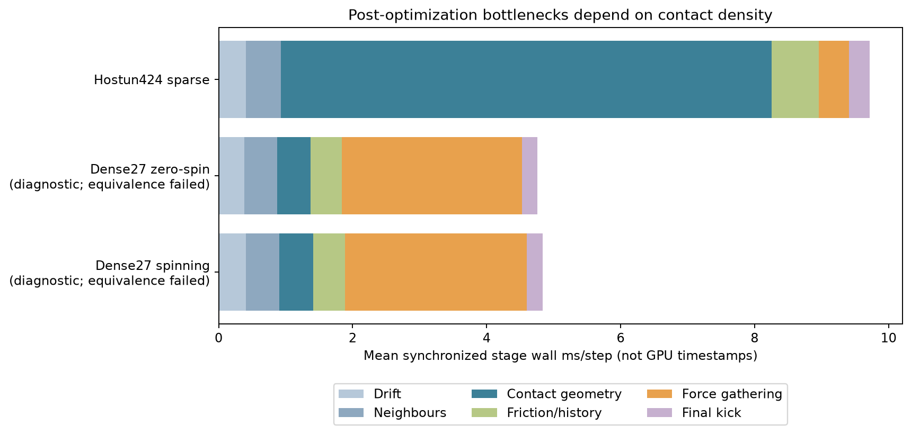

# Systematic performance follow-up

This work addresses packed-geometry caching, stronger conservative pair rejection,
GPU traversal scheduling, neighbour-list reuse and dense force reduction in that
order. It preserves the contact model, surface quadrature and timestep defaults.
The stopped Hostun preparation is not resumed. All workloads, source snapshots
and acceptance gates are frozen before execution; throughput acceptance is separate
from independent numerical verification and scientific admission.

## Packed geometry cache

The production mesh path caches its immutable packing arrays using actual vertices,
faces, ordered source samples, provenance, shape order, normalization length,
exact packer source hash, NumPy/SciPy versions and machine architecture. Units,
rounding-dependent packer code and source keys are therefore part of its identity.
The cache uses uncompressed NPZ with pickle disabled; every load verifies the
manifest, full array set, shapes, dtypes and SHA-256 of each array. Publication is
an atomic same-directory replacement. Files are private and derived, not source
geometry replacements or checkpoints. Invalid entries warn and rebuild; a cache
write failure warns and uses the freshly packed arrays.

Default location: `${XDG_CACHE_HOME:-~/.cache}/sand-atlas-dem/mesh`. Override with
`SAND_DEM_MESH_CACHE=/path/to/cache`; disable with `SAND_DEM_MESH_CACHE=off`.
`Engine.mesh_cache_receipt` exposes hit/miss/rebuild status and the cache key/path.
Deleting cache entries only causes repacking. There is no automatic eviction.

The frozen 53-shape Hostun cache study measures **97.239 s cold packing plus write**
and **0.611 s median verified cache hit** across three hits: **159.19×** for this
stage. The original HDF5 library load is 4.608 s and is excluded from this ratio;
device upload and solver setup are also excluded. The OS filesystem cache is not
flushed. All fourteen arrays are byte-identical in every trial. This improves
repeated startup/restart, not advancement throughput. Receipt:
`evidence/hostun-mesh-cache-v1/` (private cached arrays remain ignored).

The first cache revision passes 326 tests with eight skips on actual Metal,
including 14 cache-specific checks and the full existing suite. Source integrity
passes for all 235 frozen inputs: `evidence/mesh-cache-qualification-v1/`.

## Candidate studies

`hostun-systematic-performance-v1` restores the immutable dilute checkpoint used
by earlier profiling. `dense27-systematic-performance-v1` uses a declared synthetic
3×3×3 cube assembly, 100 µm side, 0.999-side spacing, Gauss3 refinement level 3 (2304 nodes per cube), fixed
1 ns conservative timestep and zero imposed loading/drag. This provides many
surface contacts per grain; it does not represent dense irregular sand.

Each compares the current 4096-workgroup collector with 256, 1024 and 16384 groups,
then tests root rejection against all six conservative hull-plane groups rather
than the existing selected group alone. Source subtrees, sample keys and exact
triangle queries stay fixed. Six restored 128-step trials per candidate use
forward/reverse order, excluding restore/warmup. A candidate requires at least
5% median throughput benefit and the existing state/force/history gates before
promotion. Separate untimed instrumented dispatches count candidate directions,
subtree tasks, visited/surviving clusters, queried samples and contacts, including
per-pair work. Counter overhead never enters throughput samples.

Synchronized wall profiles separate contact collection, friction/history,
neighbours, gathering, drift and final kick. They are not GPU timestamps; split
and ordinary trajectories must pass the same declared comparisons. The installed
Metal backend does not support indirect dispatch, so variants retain bounded
persistent pools without CPU candidate-count readbacks.

## Neighbour reuse audit

Neighbour reuse already exists. `advanceCell` clears the rebuild flag;
`checkRebuild` compares compensated center displacement and cell deformation to
half the skin. Binning and pair count/emission kernels exit when reuse is safe.
Rotation requires no extra trigger: broad-phase radii are rotation invariant,
while contact geometry is recomputed with current orientations each step. Prefix
scan/dispatch overhead can still occur; its value must be judged from the new
profile rather than implementing another neighbour list.

## Rejection and scheduling results

The sparse Hostun pool sweep passes every numerical comparison. Median wall times:

| Candidate | ms/step | Speed ratio versus baseline |
|---|---:|---:|
| 32 roots, 4096 groups (baseline) | 8.976 | 1.000× |
| 32 roots, 256 groups | 8.876 | 1.011× |
| 32 roots, 1024 groups | 8.872 | 1.012× |
| 32 roots, 16384 groups | 8.588 | 1.045× |
| All hull groups at roots | 9.682 | 0.927× |

The stronger root filter removes five directions (351 → 346), but changes neither
queried surface nodes (13,775) nor contacts (956). It adds 7.9% runtime and is
rejected. Existing hierarchical culling reduces the library's 53.6 million nodes
to this small query set; the two-active-pair count alone was insufficient to infer
profitable additional rejection. Baseline work is 12,410 visited clusters; the
most expensive pair accounts for 7155 queried nodes. Receipts:
`evidence/hostun-systematic-performance-v1/`.

A separately frozen frontier sweep tests 8/16/64/128 complete roots with the
original pool and the declared 64/128-root large-pool combinations. Only
128 roots with 16384 groups clears the unchanged 5% gate: 1.05438×, with every
state/force/torque/normal/history comparison passing. Other ratios are 0.8831×
(8 roots), 1.0379× (16), 1.0128× (64), 1.0485× (128), and 1.0399× (64/large pool).
Receipt: `evidence/hostun-frontier-performance-v1/`.

Production selection and its independent verification are recorded below. The
threshold is a scheduling heuristic, not a material property or a guarantee for
all dense/mixed libraries. Stable keys and disjoint complete tree coverage are
verified independently of which scheduling profile is selected.

## Dense gathering and retained numerical limits

The first dense study (`dense27-systematic-performance-v1`) fails during fixture
construction: subdivisions are refinement levels 0–6, not the number of intervals
along an edge. Its frozen protocol and failure are retained. V2 uses level 3 and
executes all 30 trials on actual Metal with 41,472 active surface contacts. No
scheduling/rejection candidate improves throughput meaningfully (baseline median
3.624 ms/step). Relative-torque comparisons fail even between baseline repeats in
this symmetric near-zero-torque fixture. Those results remain failed; no gate is
changed and no candidate is promoted from them.

A distinct spinning fixture declares uniform initial angular velocity
[600,800,0] rad/s before execution, retaining the same tolerances. It tests gather
workgroup sizes 1/4/8/16/32 versus 64, with six restored trials per mode. The best
median ratio is only 1.0285× (one thread/group), below the 1.05 gate. Two baseline
repeats also fail strict normal-component comparison; keys, history, state,
force and torque pass. This entire study remains failed. Changing the fixture
resolves the near-zero-torque comparison but does not establish dynamic normal
repeatability. Receipt: `evidence/dense27-gather-performance-v1/`.

Dense synchronized wall profiles suggest gathering is the leading target:
2.69–2.72 ms versus approximately 0.50 ms contact collection. These are diagnostic
wall times, with failed split/ordinary equivalence comparisons, rather than an
accepted dense throughput model or GPU-only attribution. The sparse profile is
accepted: contact geometry 7.351 ms, gathering 0.461 ms, neighbours 0.546 ms.
The workload changes the priority. No new gather kernel is promoted.

Further dense performance work should resolve the normal/near-zero-resultant
repeatability limits and evaluate a contiguous, segmented contact reduction.
Simply reducing the workgroup size is insufficient. Neighbour prefix-scan and
submission overhead remain secondary on these measured cases; existing reuse is
retained. Dense irregular Hostun, large-system scaling, thermal stability and
scientific admission remain open.

## Independent production verification and final decision

The prototype's 5.4% frontier result does not reproduce above the 5% gate after
production integration. The first integration study stops before timing: an
all-shapes-fine selector excludes Hostun's two coarse outliers (8448 and 64512
samples; library median 919488). Its precondition failure remains retained.
A separately frozen median-resolution integration passes every numerical gate
but measures only **1.03266×** (8.865 → 8.584 ms/step). The final fixed-index
specialization also passes every numerical gate but measures only **1.03388×**
(8.851 → 8.561 ms/step). Both fail the original 1.05 performance threshold.

The fine production mode is therefore **withdrawn**. The solver retains the
existing 32-root/4096-group collector and compensated force/torque reducer.
Candidate source snapshots, protocols, timings and the unexecuted candidate-only
GPU static test are preserved under
`evidence/hostun-promoted-frontier-performance-v1/` through `-v3/`. An unexecuted
test is not a qualification receipt. The historical candidate-verification driver
requires the archived candidate source; the current production engine deliberately
has no fine-selector setting. No performance threshold or numerical tolerance is
relaxed after observing these failures.

The only retained production change from this follow-up is the verified static
mesh cache. Rejection, workgroup/subtree tuning and gather scheduling remain
experimental; existing neighbour reuse remains unchanged. The original 1.41×
contact-traversal speedup from the prior task remains the accepted advancement
improvement. This follow-up establishes no additional accepted per-step speedup.

## Final checks and analysis

The retained cache-only production revision passes **329 tests with eight skips**
on actual Metal in 61.73 s, including 17 cache-specific cases. All 246 frozen
source inputs verify unchanged: `evidence/mesh-cache-qualification-v2/`. Additional
recovery checks cover malformed manifests, JSON-equivalent provenance and failed
cache writes; the initial 326-pass receipt remains retained separately.

The independent analysis verifies all eleven study/qualification source archives,
original input identities and protocol hashes, retaining failed studies as failed:
`evidence/systematic-performance-summary-v1/archive-check.json`. Its input hashes
and script snapshot are frozen separately. The chart below is diagnostic wall-time
attribution; dense profiles are explicitly marked with failed equivalence checks.

Run GPU checks serially with explicit Metal. Use fresh output directories for
studies. No raw source geometry, private cache arrays or simulation checkpoints are
added to version control, and this follow-up is local only.

The next architecture experiment is now recorded in
[SEGMENTED_FORCE_GATHER.md](SEGMENTED_FORCE_GATHER.md): contiguous parallel
reduction gives ~1.78× dense throughput, with unresolved numerical gates and no
sparse gain. It remains an experimental source generator, not a production option.
