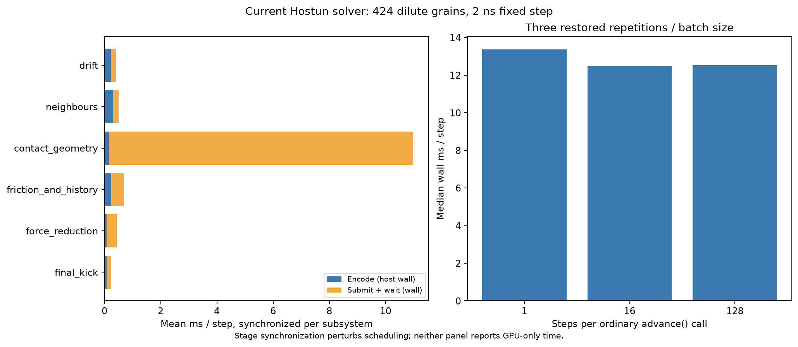

# Hostun runtime profiling

Mesh contact geometry is the main measured steady-state target. The current solver
advances the frozen dilute checkpoint at approximately 12.5ms/step. Synchronized
subsystem measurements attribute 82.9% of their total wall time to mesh contact
collection. Larger step batches provide little improvement beyond 16 steps/call.
A separate startup profile identifies substantial rebuilding of static mesh data.

## Workload and timing limits

Both studies use the immutable 500k-step checkpoint from the stopped preparation:
424 grains, 53 reused shapes, 53,564,544 quadrature nodes in the shape library,
2ns fixed step, prescribed isotropic rate -50/s and drag 1e5/s. Its shape/checkpoint
hashes are frozen in the protocols. The observed workload has 347 candidate grain
pairs, only two active pairs and 956 active surface contacts. It is dilute and
must not stand in for dense-assembly throughput or material qualification.

The old archived solver completes 384 instrumented steps at mean 12.74095ms/step.
All 384 GPU timestamp requests return `SLANG_E_NOT_AVAILABLE`; their exact failures
are retained. The current solver uses the production source at 82e07eb, including
local-frame arithmetic and active-prefix rollback. It retains the checkpoint's
**conservative** timestep policy. The opt-in active-contact checks are not timed by
this study, and no timestep/default/geometry or force law is changed.

Current measurements use three restored repetitions per batch size and three
restored 32-step subsystem sequences. Six separate command submissions per step
allow wall-time attribution. Their explicit synchronization perturbs scheduling;
these are not GPU-only kernel timings, and their sum does not predict ordinary
throughput. Encoding time is host wall time; submit/wait includes driver, queue,
execution and synchronization. Python call profiling also includes time waiting
for native/GPU operations. Do not interpret a Python function's cumulative time
as pure CPU computation. Startup is measured under cProfile, including profiler
and possible compilation overhead, rather than as an uninstrumented startup SLA.

## Current measurements

| Ordinary advance batch | Median wall ms/step | Range over 3 restored repetitions |
|---:|---:|---:|
|1step|13.3755|13.3603–13.4239|
|16steps|12.4874|12.4853–12.4945|
|128steps|12.5312|12.5221–12.6073|

Batching 1→16 cuts measured per-step wall time by about 6.6%;16→128 has no meaningful
benefit in this short sample. The old per-step instrumented mean and current
batched timings have different instrumentation and cannot establish an optimization
speedup between solver revisions.

| Synchronized subsystem | Mean wall ms/step | Host encode | Submit/wait |
|---|---:|---:|---:|
|Mesh contact geometry|10.9873|0.1522|10.8350|
|Friction/history|0.6911|0.2386|0.4526|
|Neighbours|0.5045|0.3132|0.1913|
|Force reduction|0.4414|0.0802|0.3612|
|Drift|0.4026|0.2277|0.1749|
|Final kick|0.2243|0.0795|0.1449|

Total synchronized wall time is 13.2512ms; total host encode is 1.0914ms, or 8.24%.
The ordinary 128-step Python call profile records 1792 engine dispatch calls
(14perstep), approximately0.144s cumulative in that dispatch wrapper over 128 steps.
This is consistent with host encoding being a secondary target on this workload.

The profiled startup takes 114.06s. `pack_meshes` accounts for 106.29s cumulative;
its surface-node `partition` recursion accounts for 91.01s nested within that.
The recursion is invoked 2,427,339times across 53shape roots. These nested times
must not be added. Geometry packing, rather than checkpoint advancement, dominates
this startup profile. Solver-owned logical buffers total 1,745,730,820bytes
(1.626GiB); process peak RSS is 10,486,431,744bytes (9.766GiB), including host geometry
and temporary/compiler allocations. These unified-memory categories overlap and
must not be added.



## Performance priorities

1. **Parallelize contact traversal and measure pruning work.** The existing
   `collectMeshContacts` assigns one 64-thread workgroup to each candidate pair and
   walks each directed surface hierarchy serially through uniform barriers.
   Hierarchical sample pruning and triangle BVHs already exist; adding another
   generic hierarchy is not the next step. Instrument visited clusters, surviving
   leaves, triangle-query work and per-pair imbalance, then evaluate a compact
   work queue that exposes surviving subtree/leaf work to more GPU groups.
   This is an architecture hypothesis motivated by the dominant stage, not a
   measured occupancy diagnosis or a promised speedup. A new implementation must
   preserve stable surface keys, original quadrature, common-point forces,
   friction history, capacity detection and atomic rollback.
2. **Evaluate tighter conservative pair rejection.** Only 2 of 347 candidate pairs
   have active contacts. A cheap additional pair-level separation test may avoid
   entering expensive surface traversal. Existing hull/cluster culling must first
   be counted to avoid duplicating work. Any new rejection must prove it cannot
   remove an original penetrating surface node, including concavity and both
   directed passes. The pair ratio alone does not prove a profitable filter.
3. **Cache immutable packed geometry.** Serialize mesh/BVH/hull/sample-tree data
   keyed by geometry hash, units, packing version and rounding conventions. This
   could avoid rebuilding the profiled 106s packing path on repeated case startup.
   It improves setup/restarts, rather than per-step throughput. Preserve source
   assets and verify cached bounds/keys exactly before use.
4. **Then examine friction/hash capacity work and command encoding.** These are
   smaller measured stages here. Hash clearing and full-capacity dispatches remain
   potential targets, especially when active contacts are sparse. Reuse of resource
   bindings may reduce encoding; neither is the leading measured cost. Reprofile
   after changing the contact stage and before scaling to a dense specimen.

No production optimization is implemented by this profiling task. A twofold
contact-stage improvement would imply a substantial overall opportunity under a
fixed-cost model, but synchronized wall fractions are insufficient for a credible
end-to-end speedup prediction. A dense irregular workload is still required.

## Evidence and checks

- `evidence/hostun-first-contact-profile-v1/profile/`: 384 archived-solver samples,
  backend receipt, explicit timestamp failures and original memory inventory.
- `evidence/hostun-current-runtime-profile-v1/`: 9 ordinary batch trials,128-step
  host call profile, startup call profile and 96 split steps (576 stage timings).
- `evidence/hostun-runtime-profile-summary-v1/`: separately frozen retrospective
  analysis inputs, stage ranking and inspected plot.

All frozen source/input hashes verify unchanged. Split and ordinary 32-step paths
from the identical checkpoint/warmup agree: largest normalized absolute component
error is 2.274e-13, below the predeclared 1e-5 instrumentation-comparison gate.
This checks profiling perturbation of the discrete trajectory, not scientific
accuracy. Original checkpoint/source archives and preparation status are preserved.
No preparation is resumed, and no native Atlas binary is built.

```sh
PYTHONPATH=src python examples/profile_runtime.py \
  studies/hostun-current-runtime-profile-v1.json --output evidence/runtime-new
PYTHONPATH=src python examples/summarize_runtime_profile.py \
  evidence/runtime-new --output evidence/runtime-summary-new
```

Execute GPU studies serially on Metal; use a fresh output directory. The driver
freezes the current package/shaders, its own source, protocol and input hashes
before execution. Raw geometry and checkpoints remain private. Timing measurements
are short local runs, without a claim of thermal equilibrium or dense scaling.

## Subsequent optimization

The measured contact bottleneck has now been addressed with parallel source
subtrees and hoisted pair transforms. A separately frozen current-engine serial
reference comparison measures 1.405× speedup: 12.582 → 8.954 ms/step median,
unchanged 2 ns timestep, six restored trials per mode. This remains the sparse
checkpoint workload. See [PARALLEL_MESH_CONTACTS.md](PARALLEL_MESH_CONTACTS.md) for
312-test Metal qualification, exact workload limits and retained failed revisions.

## Systematic follow-up

Verified static packing caching now addresses repeated startup. Additional
rejection and scheduling variants did not produce an accepted per-step gain after
independent production verification. Dense synthetic profiles shift the leading
cost toward force gathering, with numerical repeatability limits retained as
failed evidence. See [PERFORMANCE_FOLLOWUP.md](PERFORMANCE_FOLLOWUP.md) for the
frozen studies, decisions and cache controls. The previous profiling percentages
above remain historical measurements, not an updated universal cost model.
